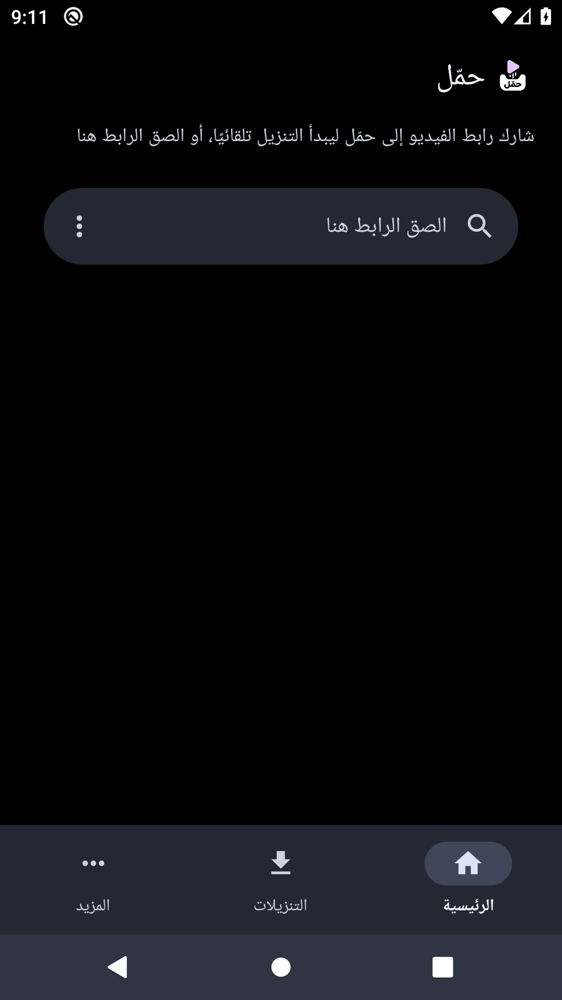
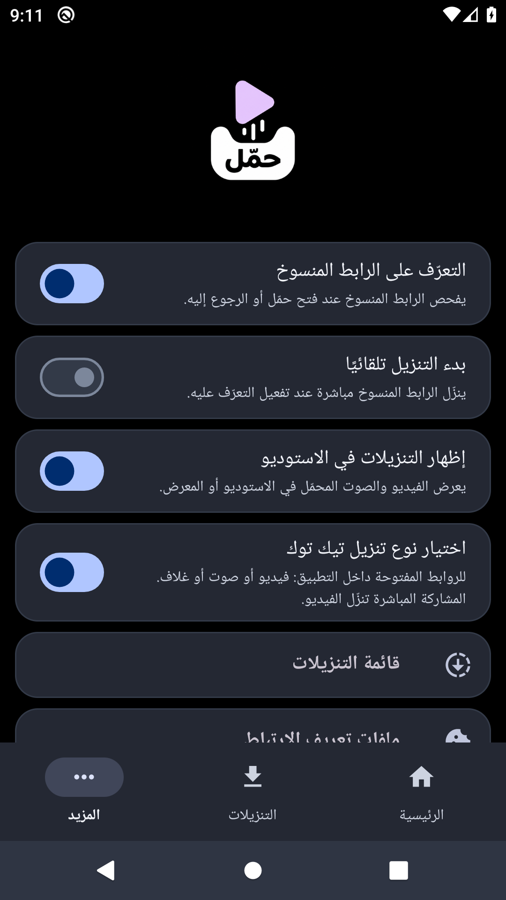
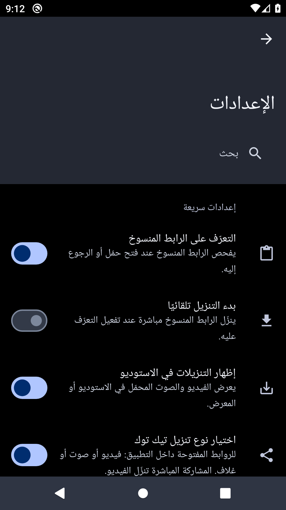
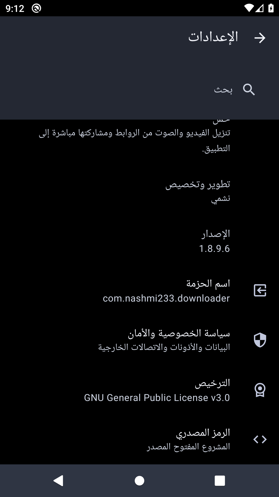

<div align="center">

<h1>حمّل · HAMMEL</h1>
<p>الفيديو والصوت، من الرابط إلى جهازك.</p>
<p>تطبيق أندرويد بواجهة عربية لتنزيل الوسائط وإدارة ملفاتك، مع مشاركة مباشرة من التطبيقات الأخرى.</p>

[تنزيل التطبيق](https://github.com/nashmi233/ytdlnis/releases) · [سجل الإصدارات](https://github.com/nashmi233/ytdlnis/releases) · [المساهمات](https://github.com/nashmi233/ytdlnis/pulls)


</div>

## تنزيل يبدأ بالمشاركة

من تيك توك أو أي منصة يدعمها محرك التنزيل، اختر **مشاركة ← حمّل** لبدء تنزيل الفيديو. ويمكنك لصق الرابط داخل التطبيق لاختيار الوسائط المتاحة. تختلف الجودة والصيغ وإمكانية التنزيل باختلاف المصدر.

## ما يقدمه حمّل

- **مشاركة مباشرة:** استقبال رابط الفيديو من التطبيقات الأخرى وإضافته إلى قائمة التنزيلات.
- **تحكم واضح:** التعرّف على الروابط المنسوخة، بدء التنزيل تلقائيًا، والحفظ في الاستوديو من صفحة «المزيد».
- **خيارات تيك توك:** اختيار فيديو أو صوت أو غلاف عند فتح الرابط داخل التطبيق؛ المشاركة المباشرة تنزّل الفيديو.
- **إدارة التنزيلات:** قائمة انتظار، متابعة التقدم، سجل للملفات وإعادة المحاولة.
- **حفظ مرن:** اختيار المجلدات، إظهار الملفات في المعرض، ونسخ الإعدادات والبيانات احتياطيًا.
- **واجهة عربية:** اتجاه من اليمين إلى اليسار، خلفية سوداء مع خانات وقوائم رمادية واضحة وشعار موحّد داخل التطبيق.

## صور من التطبيق

تُلتقط هذه الصور من ملف APK على محاكي أندرويد، دون تعديل الواجهة في الصور.

<p align="center">




</p>

## التثبيت

افتح [صفحة الإصدارات](https://github.com/nashmi233/ytdlnis/releases) واختر ملف APK الذي يتضمن اسمه **universal** المناسب لجميع المعماريات، أو ملف APK المتوافق مع جهازك إن توفر. يتطلب التطبيق Android 7.0 أو أحدث. يظهر رقم النسخة داخل الإعدادات.

تُبيّن صفحة كل إصدار حالة النسخة وتوقيعها. الإصدارات الموسومة **Pre-release / Debug** نسخ تجريبية. يتطلب التحديث فوق تثبيت سابق توافق توقيع التطبيق؛ احتفظ بنسخة احتياطية من بياناتك قبل تغيير التثبيت.

## للمطورين

الكود المخصص لحمّل موجود في فرع [`custom-app`](https://github.com/nashmi233/ytdlnis/tree/custom-app). يستخدم Kotlin وJava، ومحرك yt-dlp، ومكونات FFmpeg وAria2c لمعالجة التنزيلات. معرّف التطبيق: `com.nashmi233.downloader`.

للبناء باستخدام JDK 17 وAndroid SDK:

```sh
git clone --branch custom-app https://github.com/nashmi233/ytdlnis.git
cd ytdlnis
touch keystore.properties
./gradlew testGithubDebugUnitTest lintGithubDebug assembleGithubDebug
```

يشغّل GitHub Actions اختبارات الوحدة وفحص Android lint وبناء APK، ثم يتحقق من الواجهة على محاكي أندرويد ويلتقط صورها. راجع [نتائج التحقق وحدوده](docs/VALIDATION-1.8.9.6.md). إعداد توقيع إصدار توزيع مستقل مسؤولية من يبني النسخة.

## المشروع والترخيص

**تطوير وتخصيص: نشمي.** حمّل نسخة مستقلة مبنية على [YTDLnis](https://github.com/deniscerri/ytdlnis)، مع الاحتفاظ بإشعارات مؤلفيه ومساهميه. يستخدم محرك [yt-dlp](https://github.com/yt-dlp/yt-dlp) لتنزيل الوسائط.

المصدر متاح بموجب [GNU GPL v3.0](LICENSE). راجع [الخصوصية](PRIVACY.md) لمعرفة كيفية استخدام البيانات والأذونات. استخدم التطبيق للمحتوى الذي تملك حق تنزيله وبما يتوافق مع شروط مصدره.
