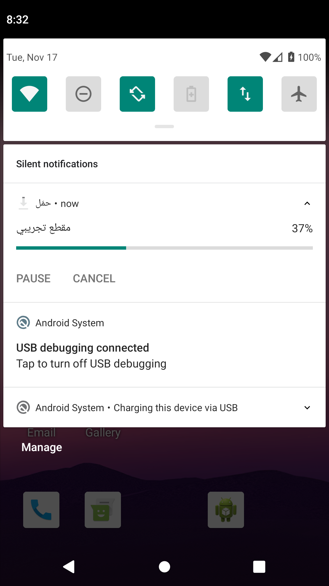
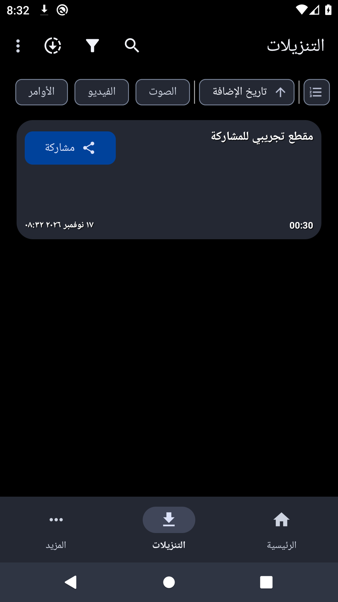
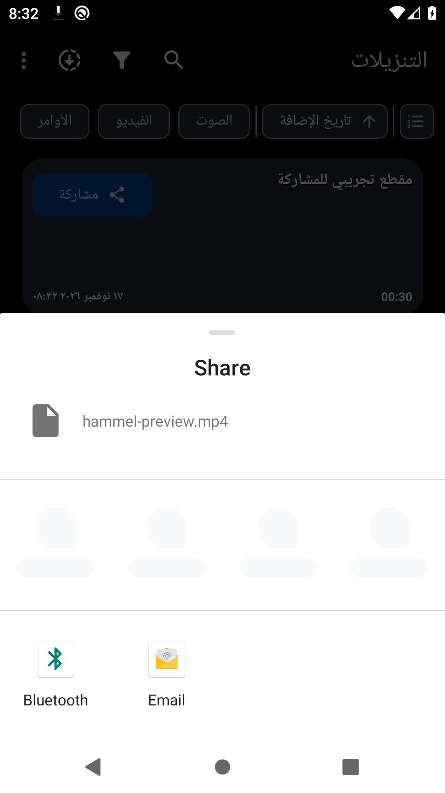

# تحقق تعديلات حمّل 1.8.9.7

تاريخ التحقق: 17 نوفمبر 2026. التعديلات في المصدر؛ لم يُنشر APK كتحديث للمستخدمين بسبب عدم توفر مفتاح توقيع مطابق للنسخ التجريبية المثبتة.

| الفحص | النتيجة |
| --- | --- |
| اختبارات الوحدة | 46 نجحت، دون فشل أو تخطٍ |
| رفض Release دون مفتاح محفوظ | نجح؛ لا رجوع تلقائي إلى Debug |
| بناء APK وتطبيق اختبارات أندرويد | نجح |
| اختبارات أندرويد على API 29 | 4 اختبارات نجحت، دون فشل |
| لقطة الإشعار وزر المشاركة وقائمة أندرويد | نجح؛ تحقق آلي ومراجعة الصور الفعلية |
| Android Lint | 30 خطأ موروثًا دون أخطاء جديدة، و590 تحذيرًا |

[تشغيل التحقق](https://github.com/nashmi233/ytdlnis/actions/runs/44046481509)

## ما تم التحقق منه

- الإشعار يعرض عنوان المقطع ونسبة رقمية وشريط تقدم، دون سجل المحرك أو مسارات الملفات. تبقى 100% محجوزة لاكتمال المعالجة وحفظ الملف.
- مشاركة مقطع واحد عبر ACTION_SEND، وعدة ملفات عبر ACTION_SEND_MULTIPLE، بروابط content URI وصلاحية قراءة مؤقتة وClipData.
- اختبار قراءة محتوى الملف المشارك، وإتاحة ملفات المزود الداخلي وfile URI، واستبعاد الروابط الشبكية والملفات المفقودة.
- اكتشف اختبار أندرويد الأول رفض روابط FileProvider القابلة للقراءة عند استخدام فحص DocumentFile؛ صُحّح باختبار فتح واصف الملف للقراءة.

## صور الفحص

الصور لواجهة التطبيق الحقيقية على محاكي أندرويد، باستخدام ملف تجريبي مسمّى بوضوح «مقطع تجريبي». نسبة 37% حالة اختبار للإشعار وليست ادعاءً بتنزيل فيديو خارجي. لم تُختبر كل المنصات أو المشاركة الفعلية إلى مستلم خارجي.

| إشعار مختصر | زر مشاركة لكل مقطع | قائمة مشاركة أندرويد |
| --- | --- | --- |
|  |  |  |

لغة نظام المحاكي إنجليزية، ولغة واجهة التطبيق عربية؛ لذلك تظهر بعض أزرار النظام والإشعار بالإنجليزية في صور الاختبار.

## حدّ التحديث

نجاح الاختبارات والبناء لا يثبت إمكانية تثبيت APK فوق كل نسخة منشورة. ما زال التحديث المتوافق مع نسخ Debug السابقة متوقفًا على مفتاح توقيعها الخاص. عُثر على مفتاح مطور محفوظ، لكنه لا يطابق بصمات ملفات التطبيق المتاحة؛ لم يُستخدم لتقديم ادعاء توافق. راجع [التوقيع والتحديث](SIGNING-AND-UPDATES.md).
